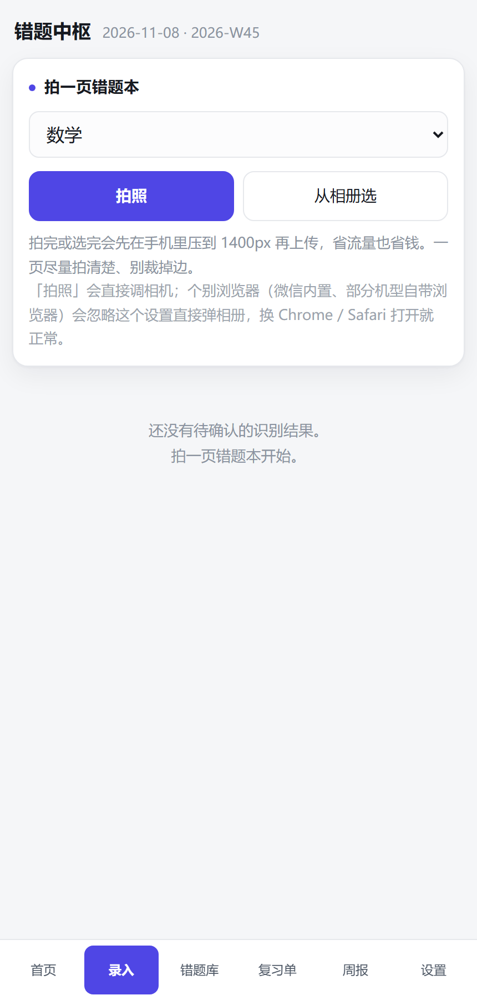
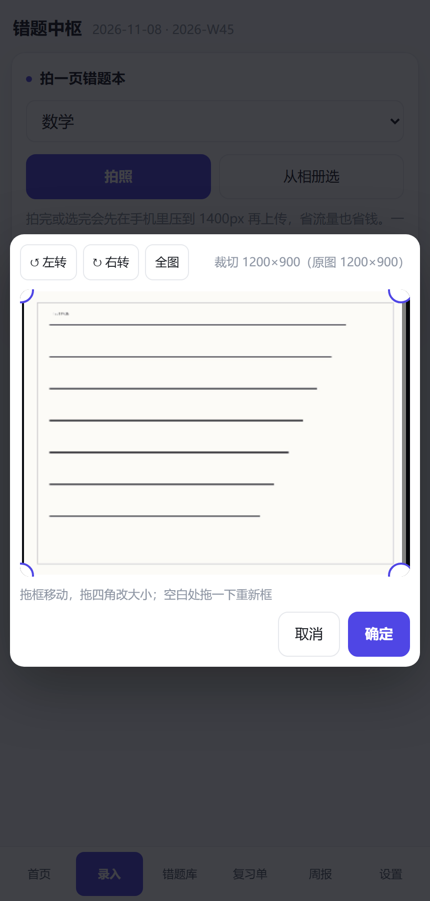
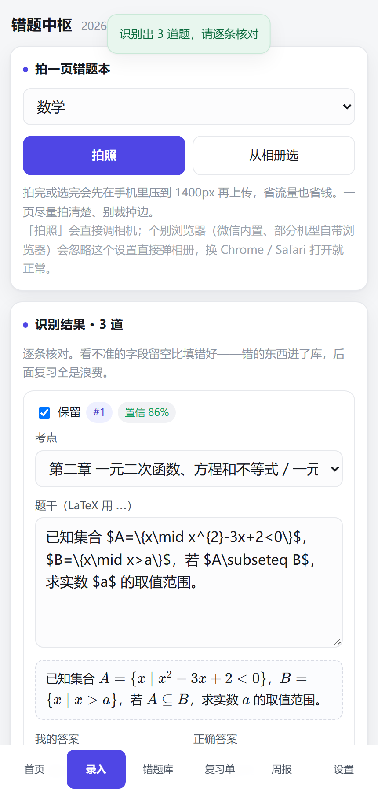
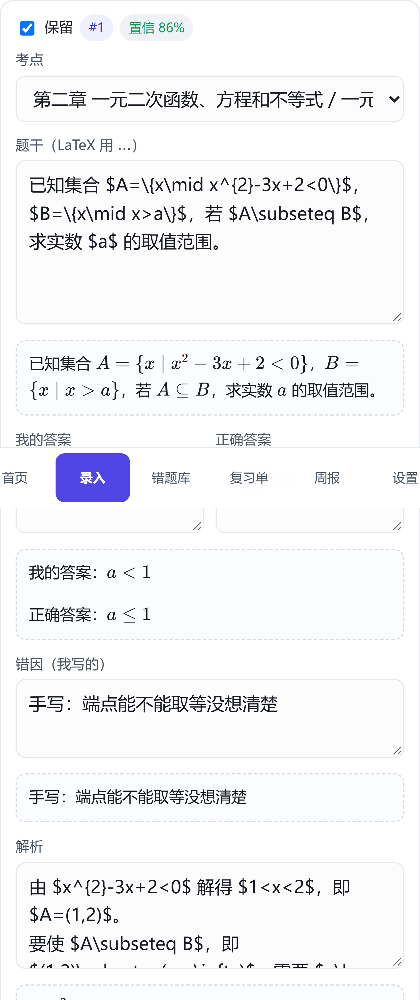

# 错题中枢 · study-os

**拍照 → AI 识题入库 → 遗忘曲线排复习 → 变式训练 → 周报/月报。**
一个跑在自己家电脑上、手机通过局域网使用的**错题闭环系统**。

<a href="https://github.com/oranskyx/study-os/actions/workflows/ci.yml"></a>

= 22.13">


<p align="center">
  
  
  
  
</p>
<p align="center"><sub>拍照录入 · 裁切旋转 · 逐条核对 · 公式即时预览</sub></p>

---

## 这是什么

错题本的价值在于**重做**，但手抄错题、手算复习间隔、手抄变式，成本高到没人能坚持一学期。
这个项目把「拍一页错题本」到「周末带一张纸质复习单回学校」的整条链路自动化了：

- **录入**：手机拍照 → 页面内裁切/旋转/压缩 → 视觉模型识题 → 逐条核对（公式边改边渲染）
- **调度**：按遗忘曲线自动排复习，做错的回退、做对的延后、30 天不错自动归档
- **训练**：AI 追问错因、生成变式题（人工审核后才入库）
- **输出**：每周一张复习单（题目页/答案页分开打印）+ 周报/月报

所有数据都在本机 `data/` 目录，不上传任何第三方服务（除了你自己配的模型接口）。

## 功能一览

| 模块 | 状态 |
|---|---|
| 拍照录入（裁切 + 旋转 + 压缩 + 上传） | ✅ |
| AI 识题（题干/答案/解析/考点/难度/错因） | ✅ 需配置视觉模型 |
| 逐条核对 + LaTeX 即时预览 | ✅ |
| 错题库（筛选、搜索、按考点聚合、批量改考点/状态/删除、详情、软删除） | ✅ |
| 错因深挖（AI 追问 + 归类） | ✅ |
| 变式训练（AI 生成 + 审核标记：可用/太难/太简单/有错） | ✅ |
| 遗忘曲线调度 + 复习单生成 | ✅ |
| 打印视图（题目页 / 答案页分开） | ✅ |
| 周报 / 月报（含图表看板：每日节奏、科目分布、错因、难度、近 6 个月趋势、环比表） | ✅ |
| 试卷分析（传原卷/答题卡/答案 → 自动判类型 → 识别 → 人工核对 → 收错题 → 失分分析） | ✅ |
| 答题卡可视化编辑（涂卡补集推导 + 黑/红笔判定 + 老师批改标记） | ✅ |
| 方法论合并（`methods` 表） | ✅ |
| 配置面板（baseURL / key / 模型列表可视化） | ✅ |
| 局域网访问 + 二维码 + 可选访问令牌（开了才要扫码鉴权） | ✅ |
| 移动端适配（360 / 390 / 414 实测） | ✅ |
| 开机自启动（交互确认）/ 停止脚本 / 防火墙放行向导 | ✅ 仅 Windows |

## 技术栈

| 层 | 选型 | 为什么 |
|---|---|---|
| 运行时 | Node.js ≥ 22.13（开发用 24） | `node:sqlite` 自 22.13 起免 `--experimental-sqlite` |
| 后端 | Express 4 + `node:sqlite` | 零原生编译，Windows 上不用 node-gyp |
| 前端 | 原生 ESM，**零构建** | 改完 `Ctrl+R` 就生效，没有 vite/webpack |
| 公式 | KaTeX（本地托管） | 国内 CDN 基本连不上，断网也要能渲染 |
| 模型 | 任意 OpenAI 兼容接口 | 换 `baseURL` 就能换厂商 |

```
浏览器（public/，零构建）
   │  fetch JSON / multipart
   ▼
Express 服务（server/index.mjs，0.0.0.0:7788）
   ├─ db.mjs       建表 + 迁移 + 数据目录
   ├─ logic.mjs    纯规则：复习间隔、状态机、组卷、周报统计
   ├─ ai.mjs       模型调用（OpenAI 兼容 /chat/completions）
   ├─ prompts.mjs  提示词（识题、追问错因、出变式、写周报）
   └─ settings.mjs 配置：库 > .env > 默认
   │
   ├──► data/study.db        SQLite（WAL）
   └──► data/uploads/        原始照片
```

分层原则：`logic.mjs` 里是**纯函数**（不碰网络、不碰 Express），所以规则可以单独测；
`index.mjs` 只做路由和 IO。加功能时保持这个边界。

## 目录

- **一、先看这个：为什么不做每日推送** —— 设计前提，改代码前必读
- **二、规则** —— 状态机、复习间隔、归档
- **三、安装与启动** —— 三条命令跑起来 / 开机自启 / 手机怎么连
- **四、配置模型** —— 在网页里点，不用改文件
- **五、每周实际怎么用** —— 周六录入、周日打单、下周回收
- **六、成本** —— 一周约两毛钱
- **七、数据在哪 / 怎么备份**
- **八、安全边界** —— 无鉴权，务必阅读
- **九、自检** —— 184 项测试，一条命令
- **十、已知限制**
- **十一、路线图**
- **十二、许可与交接**

---

## 一、先看这个：为什么不做每日推送

标准的艾宾浩斯间隔是 D+1、D+2、D+4、D+7、D+15、D+30，本质上要求每天收到提醒。
但你在校拿不到手机，每天推 20 道题你一道也执行不了，一周后系统里的数据就全是假的。

所以改成了这样：

```
周六 17:00 回家
   ↓ 拍照上传错题本（20~30 分钟）
   ↓ AI 识题 → 你逐条核对 → 入库
   ↓ 生成本周复习单 → 打印
周日 16:00 前 带着纸质复习单回学校
   ↓ 周一到周五：每天按单子做 3~4 道，只在编号旁画 √ / ×
周六 回家
   ↓ 在「复习单」页点勾回收（30 秒）
   ↓ 系统重排下一轮曲线
   ↓ 生成周报，方法论更新抄进本子
```

代价是间隔精度从"天"降到"±2 天"。对高一完全够用，而且**纸质重做本来就是最有效的复习形式**——不是妥协，是更对的方案。

---

## 二、规则（都写在代码里，可改 .env 调整）

| 规则 | 具体行为 |
|---|---|
| 状态机 | `头次错` → 错第二次自动升为 `重点错题` |
| 复习间隔 | 头次错：1/3/7/15 天；重点错题：1/2/4/7/14/21 天。走完这串之后**固定按 15 天重复**，直到 30 天不再错被归档 |
| 归档 | **30 天没再出错 → 自动归档为「已掌握」**，不再出现在复习单 |
| 做错之后 | 回到曲线起点重新走一遍，`连续做对` 清零 |
| 复习单容量 | 每天最多 4 道（`SHEET_PER_DAY`），超出的按优先级截断 |
| 复习单周次 | 周末生成的单子自动排到**下一周**——因为你在校用的是下周一到周五 |

归档规则是关键设计：它让系统**自己结束**。一道题只要一个月没再错就退出，不会像无限间隔那样把复习队列越堆越长。

---

## 三、安装与启动

前提：Node.js **≥ 22.13**（本机 24.21）。低于 22.13 的话 `node:sqlite` 还藏在
`--experimental-sqlite` 后面，直接 `npm start` 会报模块找不到。

```powershell
cd study-os
npm install
```

**双击 `start.cmd` 就能启动**（它会在一个窗口里跑服务，关窗口即停止）。

桌面上的 **「错题中枢」图标** 就是指向 `start.cmd` 的快捷方式，双击后：

- 服务没跑 → 起服务，等端口真的通了再自动打开浏览器；
- 服务已经在跑 → 不再起第二个实例，直接打开网页。

也就是说，平时**双击图标就行**，刷新页面、再点一次都不会出问题。

### macOS / Linux

`.cmd` / `.vbs` 和开机自启只有 Windows 版；其他平台直接用命令行：

```bash
git clone https://github.com/oranskyx/study-os.git
cd study-os
npm ci
npm start            # 打开 http://127.0.0.1:7788
```

手机连局域网的方式完全一样：同一个 WiFi，扫首页二维码。
注意别把 `HOST` 改成 `127.0.0.1`（那样只有本机能访问）。

### Windows：命令行启动

```powershell
npm start
```

看到这几行就成了：

```
  本机     http://127.0.0.1:7788
  局域网   http://192.168.x.x:7788   （手机用这个，实际会打印出来）
  识题模型 deepseek-flash ✓ 已配置
```

### 开机自启动（可选，装一次就行）
安装时会先问一句「要装吗」，输入 y 才动手——它写的是系统启动项，不该悄悄装。
装完不会弹黑窗口：快捷方式指向 wscript，由 VBS 用隐藏窗口拉起 cmd。

**手机连不上？** 多半是防火墙没放行入站端口。运行下面这条，会弹一次 UAC，点「是」即可：

```powershell
npm run firewall:add      # 放行 TCP 7788（需要你在 UAC 弹窗点「是」）
npm run firewall:status   # 看规则在不在
```

`start.cmd` 首次启动时也会检测并提示这一项。


装了之后，每次登录 Windows 都会**在后台**把服务起好：不弹窗口、不自动开浏览器。
好处是手机随时能连，不用先跑到电脑前双击图标。

```powershell
npm run autostart:install    # 安装（只影响当前用户，不需要管理员权限）
npm run autostart:status     # 看装没装、服务在不在跑
npm run autostart:remove     # 卸载
```

它做的事：往「启动」文件夹放一个快捷方式 → 指向 `_autostart.vbs` →
VBS 用隐藏窗口运行 `_autostart.cmd`。绕这三层只为了两件事：开机不弹黑窗口，
以及路径不写死（整个文件夹搬到别的盘，不用改任何东西）。

行为细节：

- 服务已经在跑（比如你手动双击过图标）→ 自启动会**跳过**，不会起第二个实例；
- 自启动**不打开浏览器**。想看页面就双击桌面图标，它检测到服务在跑，只开网页；
- 启动过程记在 `data/autostart.log`，服务输出在 `data/server.log`，出问题先看这两个。

### 停止服务

```powershell
npm run stop
```

或者双击 `stop.cmd`。它只杀监听 7788 的那个进程，不会误伤别的 node。

### 目录结构

```
study-os/
├─ start.cmd            双击启动：起服务 + 端口通了再开浏览器
├─ stop.cmd             停止服务
├─ _autostart.cmd       登录后静默起服务（由 VBS 调用，无窗口、不开浏览器）
├─ _autostart.vbs       隐藏启动器，路径按自身位置推导
├─ _wait-and-open.cmd   轮询 7788，通了才开浏览器
├─ mock.cmd             零成本预览用的假模型
├─ server/              后端（Express + node:sqlite，无编译步骤）
│  ├─ index.mjs         路由、静态资源、局域网地址与二维码
│  ├─ db.mjs            建表/迁移、数据目录
│  ├─ logic.mjs         遗忘曲线、组卷、周报统计
│  ├─ ai.mjs            模型调用（OpenAI 兼容协议，任意厂商可换）
│  ├─ prompts.mjs       提示词
│  └─ settings.mjs      配置优先级：库 > .env > 默认
├─ public/              前端（零构建，原生 ESM，没有打包器）
│  ├─ index.html        主页面
│  ├─ app.js            全部界面逻辑（含裁切旋转、公式预览）
│  ├─ style.css         样式 + 移动端适配
│  ├─ print.html/.js    打印视图（题目页/答案页分开）
│  └─ sw.js             Service Worker
├─ tools/               测试与维护脚本
├─ assets/              图标
└─ data/                数据库 + 上传的原图（已在 .gitignore，不进仓库）
```

### 这个项目跟 DSH 没有关系

`study-os` 是独立的 Node 程序，不依赖 DeepSeek Harness：

- 代码里没有一处 import / require 到 DSH，`package.json` 里也没有；
- 运行时依赖只有 `express`、`multer`、`katex`、`qrcode` 四个公开 npm 包；
- 它自己的数据库在 `study-os/data/study.db`，配置在自己的库里，不读 DSH 的任何配置；
- 它只是恰好**放在**当前工作目录下面。整个 `study-os` 文件夹可以整个复制到别的盘、
  别的电脑（装了 Node 就行），双击 `start.cmd` 照样跑。

---

## 四、配置模型（在网页里点，不用改文件）

打开 <http://127.0.0.1:7788> → 底部 **设置**。每一项都有：

- **服务商下拉** — 选了自动填好 Base URL 和常见模型名（8 个预设：DeepSeek / 智谱 / 百炼 / 硅基流动 / Kimi / 火山 / OpenAI / 自定义）
- **Base URL** — 手填也行，任何兼容 OpenAI 的服务都能接
- **API Key** — 密码框，保存后只显示后四位
- **模型名 + 「获取模型列表」** — 直接向服务商请求 `/models`，从下拉里选，不用背模型名
- **测试识题 / 测试写文** — 验证连通性

配置存在本机数据库里，**填完立刻生效，不用重启**。优先级：界面 > `.env` > 内置默认。

> 这个系统**不绑定任何一家**。识题必须是支持图片的模型，写文纯文本就够，两者甚至可以指向不同服务商。
> `.env` 只有两种情况下才需要动：想锁定一套默认值，或者想用环境变量管理密钥。

### 零成本预览（不用充钱）

想先看流程和排版，可以起一个本地假模型：**双击 `mock.cmd`**（或者 `npm run mock`）。

然后在设置里填：

```
Base URL : http://127.0.0.1:7799/v1
API Key  : mock
识题模型 : mock-vl-1
写文模型 : mock-text-1
```

它返回的是**写死的示例数据**，所有内容都带"模拟"标记，只用来验证页面和流程，不代表真实识别效果。

想直接看效果（不用真模型、不花钱）：先 `npm run mock` 起本地假模型，再在设置里按上面的值填，
然后 `npm run test:e2e` 会灌一批演练数据（3 道示例题 + 1 张复习单 + 周报），**跑完双击 `start.cmd` 就能点着看**。
想从空白开始：关掉服务，删掉 `data` 文件夹，重新启动。

> 注意：`npm run test:e2e` 会把配置临时切到 mock，**跑完自动还原**你原来的 key 和模型，不用手动改回来。

### 手机怎么连

**最省事的方式：扫二维码。**

1. 在电脑上打开首页，滑到底部有一张「手机上打开」的卡片，上面就是二维码
2. 手机和电脑连**同一个 WiFi**，用手机相机扫这个码
3. 打开后，浏览器菜单里点「添加到主屏幕」，桌面上就有图标了，以后像 App 一样用

二维码里编码的就是当前的局域网地址（服务启动时会打印真实 IP，不再是占位符）。
手机端界面是专门适配过的：底部固定导航、按钮高度 44px、输入框 16px（iOS 聚焦不会被强制放大）、
360/390/414 三档宽度都实测没有横向溢出。

**如果扫码打不开**，按顺序排查：

- 两边不在同一个 WiFi（电脑连了网线/热点都算不同网络）
- Windows 防火墙挡了入站。第一次启动时如果弹过提示被点了「取消」，就会一直挡着。
  用**管理员** PowerShell 放行一次即可：

```powershell
New-NetFirewallRule -DisplayName "study-os" -Direction Inbound -LocalPort 7788 -Protocol TCP -Action Allow
```

- IP 变了。家用 WiFi 是 DHCP，IP 会变。**每次都从首页那张卡片扫码**就不会遇到这个问题，
  服务每次启动打印的地址也是实时的。

> 顺带一提：`node.exe` 如果是第一次联网，Windows 会自动弹「是否允许访问网络」，
> 选**允许**（尤其是「公用网络」那一栏），否则手机连不上而本机自己访问一切正常——这个坑很隐蔽。

---

## 五、每周实际怎么用

### 周六晚上：录入（20–30 分钟）

1. 打开网页 → **录入** → 选科目 → 点「拍照」直接调相机（或「从相册选」用已有的照片，
   或者「手动录入」自己打字——不想拍照时用这个，不花钱也不会识别错）
2. 选完图先出**裁切/旋转**：拍歪了按「↻ 右转」「↺ 左转」摆正，框住要识别的区域（框外面会变暗），点「确定」
   - 图片四周留了空白，手指从图外按下去也能起框；角上的圆点加大了，好抓
   - 缩小了也能再拖回整张图，不会卡死在小框里
3. AI 识别 20 秒左右，出来一堆卡片
4. **逐条核对**。这一步不能省：
   - 识别错的题干直接改掉；**每栏下面有实时预览**，`$...$` 里的公式边打字边渲染
   - **考点是自动标注的**：模型从该科目的章节清单里挑，挑不准你再改
   - **错因会自动推断**（页面上没写也会给一条），**解析不会自动生成**——
     太难的题你也不需要它替你重做一遍，要解析去详情页点「生成解析」
   - 看不准的字段**留空比填错好**
5. 点「全部存入错题库」

入库之后所有字段都能改：错题库 → 点开任意一道 → 右上角「编辑」。

一次可以传好几页，一页一页来。

### 周日早上：排单 + 打单（10 分钟）

1. **复习单** → 生成本周复习单
2. 点「打印 / 导出 PDF」，把题目页和答案页分开打印（**答案页不要带去学校**）
3. 顺手点一下**周报** → 生成本周周报，看完把「方法论更新」抄进你的本子

### 周日回校后：执行

按复习单上标的日子做，每天 3–4 道。**做完画勾，不会的先空着别翻答案。**

### 下一个周六：回收（30 秒）

**复习单** → 对着纸上的 √/× 点一遍 → 提交。

做错的题会自动回到曲线起点重走，做对的往后推，满 30 天没再错的自动归档。

### 月底：月报

**周报** → 切到「本月」→ 生成月报。月报看的是结构问题（哪些考点反复错、哪些只是偶发）。

月报上方是**数据看板**（不花 token，直接算的）：每日做题量与正确率、复习单完成度、
科目分布、错因构成、难度分布、近 6 个月趋势、本月 vs 上月对比。
周报只有四块，刻意做轻——周日 3 分钟看完就够。

---

## 六、成本

按 DeepSeek 官方价（`deepseek-flash`，谷时半价）：

| 项目 | 单价 |
|---|---|
| 图片输入 | 每张上限 1024 tokens，约 $0.00015 |
| 输出 | $0.6 / 100 万 tokens |

一周 20 页错题本 ≈ 输入 2 万 + 输出 4 万 tokens ≈ **$0.03，约两毛钱**。一个月一块钱以内。

嫌贵可以先跑智谱的 `glm-4v-flash`（有免费额度），流程一样。

---

## 七、数据在哪 / 怎么备份

```
study-os/data/
├── study.db          ← 所有数据（SQLite 单文件，含模型配置）
└── uploads/          ← 错题本原图
```

**备份就是把 `data` 文件夹整个复制走**，没有任何其他依赖。换电脑也是直接拷过去。

**想彻底重来**：关掉服务，删掉 `data` 文件夹，重新启动即可。

---

## 八、安全边界（务必知道）

**想收紧，两个办法**：

1. **开访问令牌**（推荐，设置页一键）——开启后同 WiFi 的设备必须扫码（二维码里带令牌）
   才能访问，直接输 IP 会被挡在门外。想换固定令牌就在 `.env` 写 `ACCESS_TOKEN=...`。
2. **只允许本机**——`HOST=127.0.0.1`，手机就连不上了。


这个服务**没有登录、没有鉴权**，默认监听 `0.0.0.0`。它的设计前提是「只在自己家的局域网里用」：

- **同一个 WiFi 下的任何设备**都能打开它、看你的错题、改你的配置。别在学校/公共 WiFi 下开着。
- **API Key 以明文存在 `data/study.db`** 里。复制 `data/` 就等于交出 key——
  所以 `data/` 已在 `.gitignore` 里，**别把它传到 GitHub**。
- 界面上 key 只显示后四位，但库里是明文。这是本地单机应用的取舍，不是 bug。
- 「拉模型列表」接口**不会**把已存的 key 发往一个新的 Base URL（必须先填那家的 key），
  防止局域网里有人丢个 URL 过来把你的 key 钓走。
- 想更严格：把 `.env` 里的 `HOST` 改成 `127.0.0.1`，就只允许本机访问（手机就连不上了）。

---

## 九、自检

**一条命令跑完全部测试**（推荐，随便什么时候跑）：

```powershell
npm run test:all
```

它会在系统临时目录里新建一套**空的**数据库，另起一个服务（随机空闲端口）+ 一个 mock 模型，
跑完自动清理。所以**不会碰你真实的 `data/`，也不花一分钱**。

也可以单独跑某一项（这时需要服务已经启动）：

```powershell
npm run test:api    # 67 项：接口、调度规则、归档规则、复习单、周报统计、配置接口、二维码可扫
npm run test:ui     # 46 项：前端每个视图的真实渲染 + 点击交互 + 设置面板（跑完还原你的配置）
npm run test:math   # 15 项：KaTeX 真的执行了、公式生成 .katex、Markdown 渲染成结构
npm run test:mobile # 39 项：真浏览器引擎量 360/390/414 三档，溢出/触摸/输入框字号/拍照入口
npm run test:e2e    # 17 项：接 mock 模型跑完整链路（需先 npm run mock）
```

合计 184 项断言，`test:all` 大约 20 秒跑完。

`test:mobile` 用的是电脑上的 Edge（无头模式 + DevTools 协议），所以在真浏览器引擎里量尺寸，
不是 jsdom 那种没有排版的假数据。它会连同局域网地址一起测，等于顺便验证了「手机走局域网能打开」这条链路。

`test:ui` 里依赖 mock 的 4 项，mock 没跑时会标成「跳过」而不是失败。
`test:ui` 会临时改配置（把模型指到 mock），跑完自动还原成你原来的设置——用了整表快照，中途崩了也会还原。

单独跑 `test:api` / `test:ui` / `test:e2e` 会往**真实库**写数据（`test:ui` 造的临时题会真删掉，
`test:api` 造的题跑完也会清理；`test:e2e` 的演练数据默认保留，加 `--clean` 才删——
注意 `--clean` 是**跑完就删**，不是跑前清空，别搞反了）。
想让演示数据重新干净，就停服务 → 删 `data/` → 重启 → `npm run test:e2e`。

> 想不污染真实数据又只想跑某一个套件：用 `npm run test:all`，或者自己指定
> `DATA_DIR` 和 `PORT` 另起一个实例。

---

## 十、已知限制

1. **手写识别不是 100%**。字迹潦草、公式复杂、有几何图时会错，所以「逐条核对」必须做。
2. **几何图和函数图象识别不了**，会留下占位符，需要你自己看图。
3. **考点树覆盖六科**（数学 28 + 语文/英语/物理/化学/生物各 20 条左右，共 129 条），
   但都是「人教版必修」的主干考点，细到某个小节可能还要你自己补。
4. **变式题质量需要你把关**。小考点换数换情境 AI 做得不错，大模块综合题还是教辅更靠谱。
5. **服务只在电脑开着的时候能用**。电脑关机 = 服务停，手机也连不上。
6. **`start.cmd` 的窗口关掉服务就停**。想登录后自动起，用 `npm run autostart:install`（见「三、安装与启动」）。
7. 数学公式用本地 KaTeX（`node_modules/katex`，经 `/vendor/katex` 提供），**不走 CDN**，
   断网照样渲染——国内 jsdelivr 基本连不上，之前公式全退化成 `$...$` 就是这个原因。
8. **端口改成 7788 以外的值，要同步改 4 个 `.cmd`**：`start.cmd`、`stop.cmd`、
   `_autostart.cmd`、`_wait-and-open.cmd` 里都写死了 `7788`。改一个不改其余，
   会出现「端口明明在跑却提示没起」或「停不掉」的怪现象。

---

## 十一、路线图

按「对体验的影响」排序，不是承诺，想到才做。

**P1 · 最影响体验**

- [ ] **补齐五科考点树** —— 现在只有数学 28 条（人教 A 版必修一），其余五科 `kps` 表是空的，
      考点下拉只有「未标注」，周报的考点趋势也只有数学有意义。
- [ ] **成绩 / 排名模块** —— 新表 `exams(id, subject_id, date, score, full_score, rank, total_students)`，
      `#/exams` 画成绩曲线 + 与复习量的相关性。

**P2 · 值得做**

- [ ] 家长看板：只读的 `#/parent` 视图（本周做了多少题、正确率、复习完成度）。
- [ ] 教辅变式手工录入 UI：`POST /api/questions/:id/variants/manual` 接口已有，前端没入口。
- [ ] `test:math` 自造数据，去掉对 `test:e2e` 的顺序依赖。
- [ ] 拆分 `server/index.mjs`（已 700 行）为 `routes/question.mjs` / `routes/sheet.mjs` 等。
- [ ] 数据导出：`GET /api/export` 返回全量 JSON，方便换机或备份。

**P3 · 锦上添花**

- [x] GitHub Actions 跑 `test:all`（见 [`.github/workflows/ci.yml`](.github/workflows/ci.yml)；
      `test:mobile` 在无 Edge 的 Linux 上自动跳过）。
- [ ] PWA 缓存版本号 `public/sw.js` 里的 `const CACHE = 'cuoti-v1'` 目前写死，
      需要强制刷新壳子时手动改。

---

## 十二、许可与交接

代码以 **MIT 许可**发布，见 [LICENSE](LICENSE)。

要接着开发（或者换一台电脑/换一个 AI 会话接着写），先看 **[HANDOFF.md](HANDOFF.md)**：
里面写了架构、数据表、接口清单、踩过的坑、以及还没做完的事。
